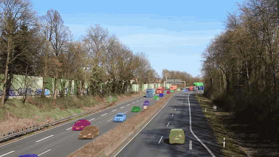
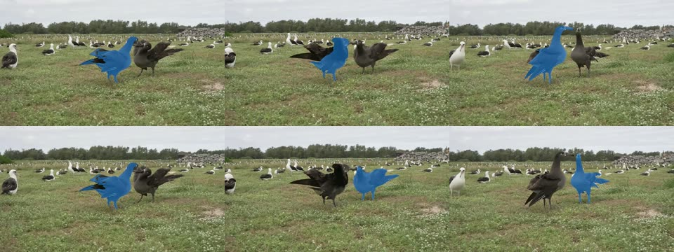
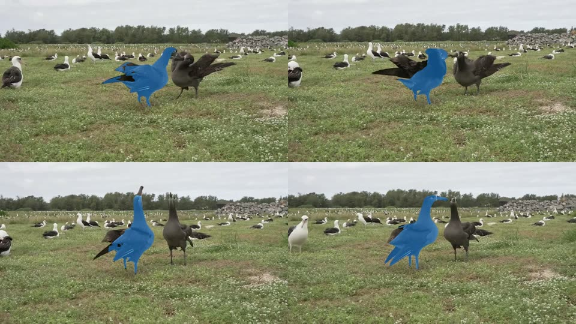
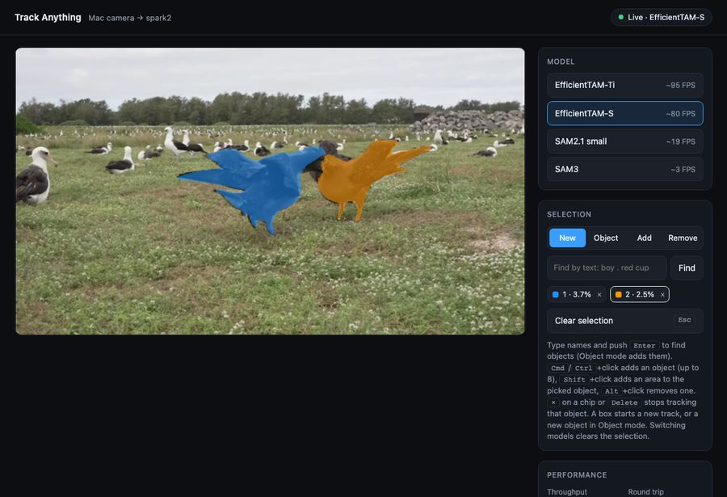

# TrackAnything

Track any object in video with EfficientTAM, SAM2.1 or SAM3: prompt with a point or a box, and the model follows it frame by frame. The project is managed locally with uv on a Mac and runs on `spark2` (DGX Spark, GB10, CUDA 13).

**Blog post: [TrackAnything: Click an Object, and a DGX Spark Follows It](https://thunderheadxpler.blogspot.com/2026/11/trackanything-click-object-and-dgx.html)**

Two entry points:

- **Offline benchmark** (`track.py`): track one object through a video file, time it, write an overlay video.
- **Live app** (`live.py` + `live.html`): the Mac camera streams to spark2, and the browser shows the tracked mask over the live video.

The full manual is [`docs/index.html`](docs/index.html): open it in a browser. It covers procedures, how the tracking works, the WebSocket messages, performance and troubleshooting, with screenshots and diagrams.

## Samples

<table>
  <tr>
    <td></td>
    <td></td>
  </tr>
  <tr>
    <td><b>Traffic</b>, <code>--text "car . truck" --threshold 0.30 --redetect 15</code>, EfficientTAM-S, 2.0 FPS with up to 44 objects. New vehicles get a mask as they enter. The detector also takes a road sign for a vehicle.</td>
    <td><b>Garbage cans</b>, <code>--text "garbage can . trash can"</code>, EfficientTAM-S, 61.9 FPS. Background blurred by <code>tools/anonymize.py</code>.</td>
  </tr>
</table>

Traffic video: ["Motorway A40 - on bridge above the traffic"](https://commons.wikimedia.org/wiki/File:Motorway_A40_-_on_bridge_above_the_traffic.webm) by Kathinka Engels / Sounds of Changes, [CC BY 3.0](https://creativecommons.org/licenses/by/3.0), via Wikimedia Commons. Changes: audio removed, trimmed to 10 seconds from 0:06, resized, frame rate reduced, tracking masks added.

Albatross video: ["Black-footed albatross mating dance"](https://commons.wikimedia.org/wiki/File:Schwarzfu%C3%9Falbatros_(Phoebastria_nigripes),_Paarungstanz_(Balz)_im_Midway_Atoll_National_Wildlife_Refuge.webm) by USFWS Pacific Region, video by volunteer Dan Rapp, public domain, via Wikimedia Commons. Changes: audio removed, trimmed to 10 seconds from 0:08, resized, tracking masks added.

## Requirements

- SSH access to `spark2` (override with `HOST=...`) with uv at `~/.local/bin/uv`. The first run syncs the environment there: torch and torchvision come from the PyTorch cu130 index.
- On the Mac: `ssh`, `rsync`, `curl` and a browser with WebGL2 (Chrome or Safari). No local Python environment is needed.
- SAM3 only: `HF_TOKEN` in your environment, with access granted to the gated `facebook/sam3` repo. The scripts pass it to spark2 over stdin, never on the command line.

## Offline benchmark

```bash
./run_spark2.sh data/albatross.mp4 --point 470,260 --out results/birds_s.mp4             # EfficientTAM-S 512 (default)
./run_spark2.sh data/albatross.mp4 --point 470,260 --model ti --out results/birds_ti.mp4  # EfficientTAM-Ti 512
./run_spark2.sh data/albatross.mp4 --point 470,260 --model sam3 --out results/birds_sam3.mp4 # SAM3 tracker
./run_spark2.sh my.mp4 --box 100,80,300,400 --runs 5 --no-compile --out results/my_box.mp4
./run_spark2.sh data/garbage_cans.mp4 --box 248,617,392,785 --out results/garbage_cans_blue.mp4   # blue cart
./run_spark2.sh data/garbage_cans.mp4 --box 392,624,498,761 --out results/garbage_cans_brown.mp4  # brown cart
./run_spark2.sh data/garbage_cans.mp4 --text "garbage can . trash can" --out results/cans.mp4      # both, by text
./run_spark2.sh data/albatross.mp4 --point 470,260 --fix-box 75:1:548,172,742,315 --out results/fix.mp4  # correct object 1 at frame 75
./run_spark2.sh data/albatross.mp4 --box 338,157,592,360 --box 570,172,788,330 --out results/birds.mp4  # two birds
```

Corrections on a later frame (EfficientTAM only, manual 5.7): `--fix FRAME:OBJ:x,y:+` (add) or `:-` (remove), and `--fix-box FRAME:OBJ:x0,y0,x1,y1`, in that frame's pixels, repeatable. The corrected frame becomes a new prompt frame for that object, the object's older memory is dropped, and tracking runs again from the first corrected frame (frames before it keep their masks). One fix at frame 75 of `albatross.mp4`: 44.5 FPS for the two passes, against ~100.



*Frames 0, 75 and 299. Top: one point on the left bird. Bottom: the same point and `--fix-box 75:1:548,172,742,315`, which moves the track to the right bird from frame 75. EfficientTAM-S, 44.5 FPS for the two passes.*

`run_spark2.sh` rsyncs this folder to `spark2:~/GWorkspace/TrackAnything`, runs `uv run track.py` there and copies `results/` back. The prompt is in frame-0 pixels. The first run includes warm-up and `torch.compile`.

FPS is the wall time of `propagate_in_video` over all frames (model plus mask copy to CPU), with bf16 autocast and the EfficientTAM image encoder compiled.

Objects that enter later (EfficientTAM only, manual 5.8): `--text "car . truck" --redetect 15` runs the detector every 15 frames, skips boxes with IoU ≥ 0.5 against a tracked mask's box, starts a track for each other box, removes it if its first mask lies on a tracked mask, and ends tracks that stay empty for 15 frames or cover a quarter of the frame. On the motorway clip: 52 objects at 2.0 FPS, against 19 objects at 3.8 FPS with one detection. Offline only.

Results (2026-11-04, spark2 GB10, torch 2.14.1+cu130, `albatross.mp4` 300 frames 960×540, one object):

| Model | FPS (3 runs) | Peak GPU mem |
| --- | --- | --- |
| EfficientTAM-S 512 | 94.3 / 78.5 / 102.9 | 1282 MiB |
| EfficientTAM-Ti 512 | 111.0 / 93.6 / 112.3 | 1218 MiB |
| SAM3 tracker (1008, bf16) | 2.7 / 2.7 / 2.7 | 9344 MiB |



*`./run_spark2.sh data/albatross.mp4 --point 470,260`: one point on the left bird in frame 0, EfficientTAM-S, 78.5–102.9 FPS. The mask follows the bird through the dance, but it misses part of the dark wing in some frames.*

SAM3 (`transformers` `Sam3TrackerVideoModel`, 466M parameters in the tracker) runs at about 1/38 of the speed of EfficientTAM-S on this clip, and gives a better mask: it keeps the spread wing, which EfficientTAM-S loses in some frames. Its image encoder alone takes about 300 ms per 1008×1008 frame (eager PyTorch, SDPA, not compiled).

Each `--point`/`--box` is one object (repeat them for more); `--text "a . b"` adds one object per box that the detector (LLMDet tiny, `detector.py`) finds on frame 0. Each object gets its own colour and an area line. Tracking both cans in one run costs 61.8 FPS instead of ~103 for one.

Second sample, `data/garbage_cans.mp4` (720×1280 portrait, 321 frames, camera moving round two garbage cans): EfficientTAM-S tracks each cart through all frames at ~103 FPS; SAM3 tracks the blue cart at 2.7 FPS (one run). Personal data was removed before the clip went into `data/`: no metadata (GPS, device, dates) or audio, background blurred outside the tracked cans, house numbers on the carts pixelated (manual 5.4, 5.5). The tool that did this is `tools/anonymize.py`; from the Mac run `./anonymize_spark2.sh SRC data/NAME.mp4 --subject "names"`, then check `results/NAME_sheet.jpg` before committing.

## Live app: Mac camera → spark2 → browser

```bash
./live_spark2.sh                  # starts with SAM2.1 hiera-small (default)
./live_spark2.sh --model etam-s   # starts with EfficientTAM-S; also etam-ti, sam3
pkill -f live_spark2.sh           # stop (or Ctrl-C in the launcher): also stops the server on spark2
```

The launcher syncs the folder, starts `live.py` on spark2, opens an SSH tunnel and opens http://localhost:8765 (override with `PORT=...`). The server binds to 127.0.0.1 only. Browsers allow camera access only on localhost or HTTPS, which is why the app goes through the tunnel. The server has one shared tracker, so it serves one tab at a time: a second tab shows "Busy · retrying" and connects when the first one closes. The server accepts pages from localhost only (other sites get HTTP 403), answers a bad message with `message_error`, and clears the track when a viewer connects or the tracker fails (manual 9.3).



*The live app with two objects from two boxes, EfficientTAM-S. Object 1 is blue, object 2 is orange.*

In the page:

- **Track:** click an object, or drag a box around it.
- **Find by text:** type names in the Find field (`boy . red cup`) and push Enter. A detector (LLMDet tiny) finds the boxes once, in the next frame; each box becomes an object that the tracker follows. Object mode adds them to the current track and skips boxes on objects already tracked. The first query loads the detector (~5 s); later ones take ~0.2 s.
- **More objects:** Cmd/Ctrl+click (or Object mode, which also takes a box) adds another object, up to 8, each with its own colour and chip. Click a chip to pick the object that corrections change. Each object adds time per frame: EfficientTAM-S 102 → 62 → 35 FPS for 1, 2 and 4 objects (tracker only).
- **Remove one object:** × on its chip, or pick the chip and press Delete. The others keep tracking with the same numbers and colours.
- **Correct:** Shift+click adds an area to the mask, Alt/Option+click removes one (or pick New / Add / Remove in the Selection panel). The track and its memory continue. Remove takes out part of the mask, and the result is not exact (manual 6.3).
- **Clear:** press the Clear button or Esc.
- **Model:** pick EfficientTAM-Ti, EfficientTAM-S, SAM2.1 small or SAM3 in the side panel. A model loads on first use (EfficientTAM compiles, so up to a minute) and then stays loaded, so switching back is instant. Switching clears the selection. If a model cannot load (for example SAM3 without `HF_TOKEN`), the page shows the error and keeps the current model.
- **Performance panel:** throughput, round trip, server time per frame and total mask area.

### How it works

1. The page captures the camera (at most 640 px wide) and sends one JPEG frame at a time over a WebSocket. It sends the next frame as soon as the previous reply arrives, so there is no queue.
2. spark2 decodes the JPEG on the GPU (nvJPEG). After a text query, the detector turns the names into boxes on that one frame, and the boxes become box prompts (detect, then track). It runs the tracker and returns the model's low-res mask logits as raw float16, one grid per object (128² for EfficientTAM, 256² SAM2, 288² SAM3; 32–162 KiB per object per frame).
3. A WebGL2 shader on the Mac upsamples the logits bilinearly (one texture-array layer per object), gives each pixel to the object with the highest logit above 0, and colours it over the live video. This gives the same mask as server-side post-processing (IoU 1.0 over 100 frames). uint8 logits were tried and moved the edges (IoU 0.91).

EfficientTAM has no streaming API upstream: `live.py` feeds frames one at a time into its video predictor. Both tracker types keep only the last 16 non-conditioning frames, plus the prompt frame and one conditioning frame per correction. Without corrections, memory and latency stay flat; each correction adds a little memory and attention cost.

### Live performance

Measured end to end over the WebSocket on spark2 (640×360 frames from `albatross.mp4`, 600 frames):

| Model | Throughput | Round trip |
| --- | --- | --- |
| EfficientTAM-Ti 512 | 93.0 FPS | 9.7 ms median |
| EfficientTAM-S 512 | 83.4 FPS | 10.9 ms median |
| SAM2.1 hiera-small | 19.2 FPS | 50.7 ms median |
| SAM3 tracker | 2.9 FPS | 341 ms median |

These numbers exclude the Mac-to-spark2 network hop. In the browser, throughput is also capped by the camera frame rate.

Text queries (LLMDet tiny + EfficientTAM-S, spark2): first query 5.7 s (detector load), later queries 232–243 ms from query to first mask, then 57–58 FPS round trip for two objects (query `dark bird`). Detector bake-off on `albatross.mp4` (spark3, bf16): Grounding DINO tiny 0.85, MM Grounding DINO tiny 0.87, LLMDet tiny 0.87 and base 0.88 box IoU at 207–243 ms; OmDet-Turbo tiny 0.54 at 33 ms (needs `timm`, misses `rocks`); SAM3 image model 0.89 at 685 ms (spark2). LLMDet tiny is used: widest vocabulary of the small models (LVIS minival 50.7 AP) and no new dependency. Manual 10.4 has the full table.

SAM2 time per frame (earlier measurement): preprocessing 2 ms, image encoder 21 ms; the rest is memory attention, the mask decoder and overhead. hiera-tiny is no faster (47.8 ms).

## Tests

```bash
./test_spark2.sh                       # GPU suite on spark2 (unittest, ~6 min, EfficientTAM-S): tracker, text, WebSocket, offline tools, --fix, --redetect
TEST_MODEL=sam2 HOST=spark3 ./test_spark2.sh -k test_tracker   # other model / host / subset
NO_OPEN=1 ./live_spark2.sh --model etam-s &                    # page check on the Mac (close other tabs on the app first)
uv run --no-project --with playwright python tests/page_check.py
```

Results 2026-11-04, on `data/albatross.mp4`: spark2 EfficientTAM-S 37/37 OK; spark3 SAM2.1 `test_tracker` + `test_ws` + `test_text` 25 OK, 1 skipped; spark3 EfficientTAM-Ti `test_tracker` 9 OK, 1 skipped (these models ignore add points on the other bird). Page check OK in Chromium and WebKit (canvas camera, no clip).

## Notes

- EfficientTAM comes from the upstream repo (`yformer/EfficientTAM` @ `abcd061`, checkpoints `efficienttam_{s,ti}_512x512.pt` from Hugging Face). Its wheel omits the Hydra YAMLs, so `configs/` holds copies of the two 512×512 configs. Refresh them when you change the pinned revision.
- The upstream CUDA extension `_C` is not built, so mask hole-filling is skipped (upstream warns and continues).
- `torch.compile` works for the EfficientTAM image encoder but fails for the SAM2 encoder on this Triton build (`KeyError: triton.language.bfloat16`), so SAM2 runs eager.

### Crowd smoke test (22 players)

An overhead team-sport clip (scratch scripts, not the live app, which allows 8 objects): LLMDet finds all 22 players on frame 0 at box threshold 0.30 (20 at the default 0.35). Detect-once + SAM2.1 keeps 20 masks at 1.6 FPS with few identity jumps; EfficientTAM-S keeps 19 at 6.8 FPS but merges masks in the pile. A prototype with re-detection every 15 frames and box-IoU matching made duplicate masks; `--redetect 15` compares masks and ends tracks: 27 objects at 2.8 FPS, masks still merge in the pile. YOLO26 + ByteTrack/BoT-SORT ran at 56–71 FPS but fragmented identities (65–81 IDs for 22 players) and is not used: AGPL-3.0, no Ultralytics licence. Manual 10.5 has the tables.

## References

- [SAM 2](https://ai.meta.com/research/sam2/) (Meta, arXiv 2408.00714): streaming memory design used by every tracker here.
- [EfficientTAM](https://yformer.github.io/efficient-track-anything/) (arXiv 2411.18933): plain-ViT encoder and efficient memory attention; the `etam-ti`/`etam-s` models.
- [Track-Anything](https://github.com/gaomingqi/Track-Anything) (arXiv 2304.11968, MIT): SAM + XMem + E2FGVI inpainting.
- [Segment-and-Track-Anything](https://github.com/z-x-yang/Segment-and-Track-Anything) (arXiv 2305.06558, AGPL-3.0: methods only, do not copy code): SAM + DeAOT + Grounding-DINO text prompts.
- [LLMDet](https://huggingface.co/iSEE-Laboratory/llmdet_tiny) (arXiv 2501.18954, Apache-2.0) on the [MM Grounding DINO](https://huggingface.co/docs/transformers/model_doc/mm-grounding-dino) architecture (arXiv 2401.02361): the text detector used here. [Grounding DINO](https://arxiv.org/abs/2303.05499) (arXiv 2303.05499) is the original; Grounding DINO 1.5/1.6 and DINO-X are API-only, and there is no "Grounding DINO 3".
- [OmDet-Turbo](https://huggingface.co/docs/transformers/model_doc/omdet-turbo) (arXiv 2403.06892): faster alternative (32 ms) with a smaller vocabulary. [YOLOE](https://docs.ultralytics.com/models/yoloe) is AGPL-3.0, not used.
- [Grounded-SAM-2](https://github.com/IDEA-Research/Grounded-SAM-2): the detect-then-track pattern (detector boxes as SAM 2 box prompts).

Section 14 of the manual lists which of their methods this project already uses and which it can add, with the work list: correction points, multi-object tracking, text prompts, single-object removal, offline go-back-and-correct and offline re-detection (done); next: tracking by detection without YOLO.

## License

[Apache-2.0](LICENSE). Third-party material is listed in [`NOTICE`](NOTICE): `docs/img/traffic.gif` is under CC BY 3.0, `data/albatross.mp4` and the images made from it are public domain, and models and dependencies are downloaded under their own licenses.
